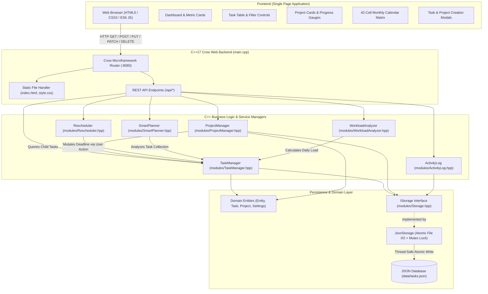
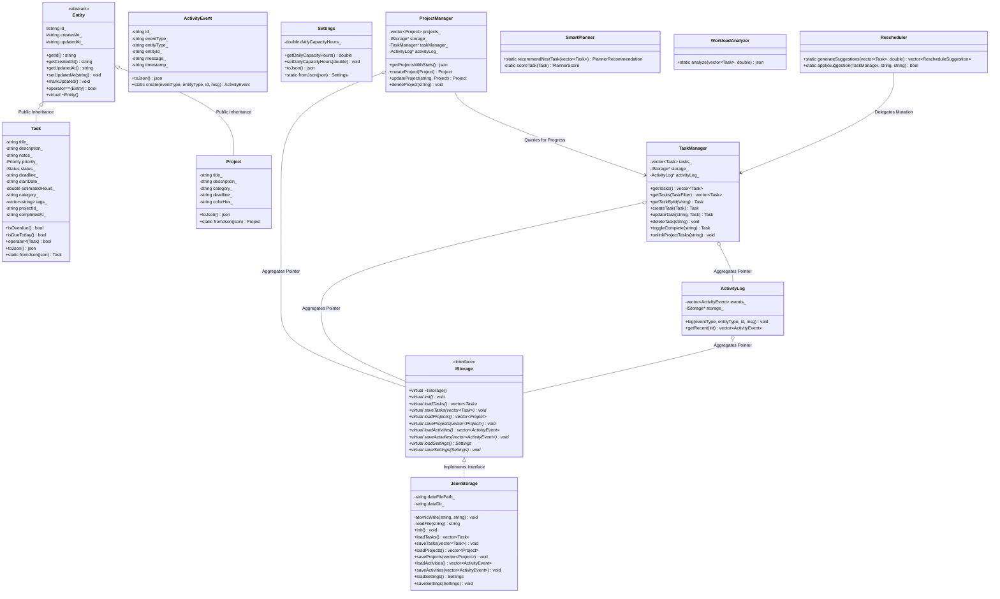
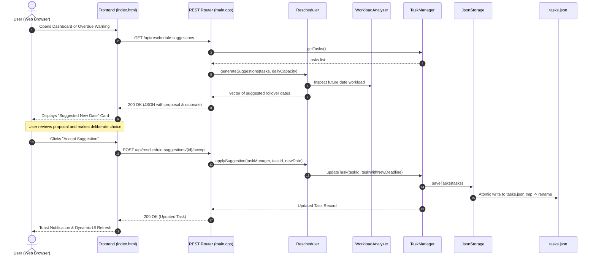
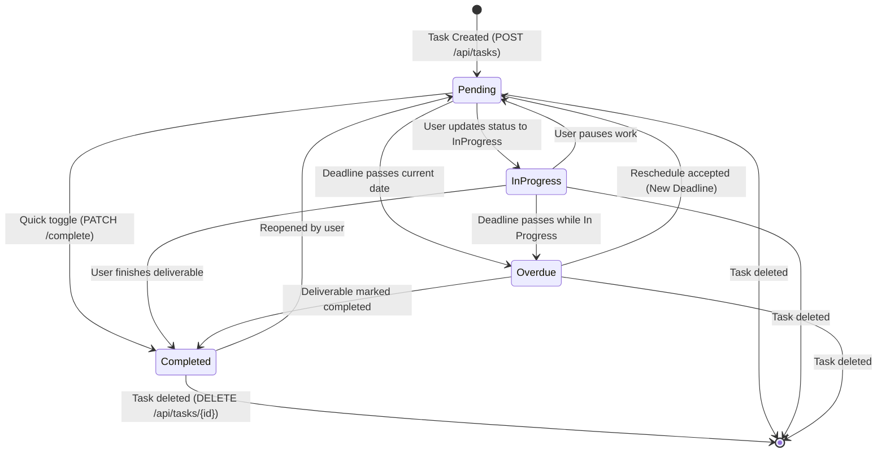

# TaskFlow – Smart Personal Task Management System

[](https://en.cppreference.com/w/cpp/17)
[](https://crowcpp.org/)
[](https://json.nlohmann.me/)
[](https://apple.com)
[](#)

> **TaskFlow** is an offline-first, high-performance personal productivity system built as an **Object-Oriented Programming (OOP) mini-project** for college curriculum. It couples a robust **C++17 Crow REST backend** with a calm, responsive, and accessible **HTML5/CSS3/ES6 single-page web interface**.

---

## Table of Contents

1. [Executive Summary & Motivation](#1-executive-summary--motivation)
2. [Key Capabilities & Features](#2-key-capabilities--features)
3. [Architecture & System Design](#3-architecture--system-design)
   - [System Architecture Flowchart](#system-architecture-flowchart)
   - [OOP Class Hierarchy Diagram](#oop-class-hierarchy-diagram)
   - [Task Rescheduling Lifecycle Sequence](#task-rescheduling-lifecycle-sequence)
   - [Task State Machine Diagram](#task-state-machine-diagram)
4. [Comprehensive OOP Concepts Mapping](#4-comprehensive-oop-concepts-mapping)
5. [Core Modules & Class Responsibilities](#5-core-modules--class-responsibilities)
6. [Technology Stack & Prerequisites](#6-technology-stack--prerequisites)
7. [Installation & Setup Guide](#7-installation--setup-guide)
8. [Build & Execution Commands](#8-build--execution-commands)
9. [REST API Reference](#9-rest-api-reference)
10. [Repository Directory Structure](#10-repository-directory-structure)
11. [Testing & Quality Verification](#11-testing--quality-verification)
12. [College Viva & Academic Defense Q&A](#12-college-viva--academic-defense-qa)
13. [Limitations & Future Roadmap](#13-limitations--future-roadmap)

---

## 1. Executive Summary & Motivation

### The Problem
Individual learners, researchers, and developers constantly juggle overlapping deadlines, ambiguous priorities, and fluctuating daily bandwidth. Most digital solutions fall into one of two extremes:
* **Over-simplified to-do lists**: Lack intelligence, capacity planning, and contextual project grouping.
* **Bloated enterprise tools**: Require cloud connectivity, expensive subscriptions, and heavy team tracking features irrelevant to solo work.

### The Solution: TaskFlow
TaskFlow delivers a dedicated personal workspace that:
1. **Runs 100% Locally**: Zero cloud subscriptions, zero telemetry, zero privacy exposure.
2. **Prioritizes Deterministically**: Employs a local C++ algorithmic scoring engine that highlights what to work on next with transparent human reasoning.
3. **Guards Against Burnout**: Continuously monitors daily scheduled hours against a customizable working capacity (e.g., 6.0 hours/day).
4. **Reschedules Non-Destructively**: Suggests realistic deadline adjustments for overdue tasks without modifying user records without explicit consent.
5. **Demonstrates Academic OOP Rigor**: Adheres to modern C++ software design patterns, abstraction boundaries, robust custom exception hierarchies, and clean memory ownership.

---

## 2. Key Capabilities & Features

### A. Executive Dashboard
* **Dynamic Metric Tiles**: Instant summary of Total, Pending, In-Progress, Completed, Overdue, and Due-Today tasks.
* **Velocity Gauge**: SVG circular indicator computing real-time task completion percentage.
* **"Next Focus" Recommendation Hero**: Prominently highlights the highest-priority actionable task with deterministic score explanations.
* **Urgency & Deadline Watchlists**: Surface immediate deadlines and critical items at a glance.
* **Live Audit Activity Feed**: Real-time chronological log of recent actions.

### B. Personal Task Management
* **Complete CRUD**: Create, edit, toggle completion, and delete tasks.
* **Rich Metadata Attributes**: Title, description, extended notes, priority (`Low`, `Medium`, `High`, `Critical`), status (`Pending`, `In Progress`, `Completed`), deadline, start date, estimated hours (`0.1h` to `100.0h`), category, tags, and project binding.
* **Real-Time Client-Side Search**: Instant keyword search across titles, descriptions, and tags.
* **Multi-Criteria Filtering & Sorting**: Filter by status, priority, category, or project; sort by deadline, priority weight, creation date, or alphabetical title.
* **Input Validation & Safety**: Server-enforced boundary validation with frontend error toasts and modal confirmation safeguards.

### C. Personal Project Initiatives
* **Project Organization**: Group tasks under overarching initiatives with customized color tags, deadlines, and descriptions.
* **Aggregated Progress Metrics**: Dynamically rolls up completed vs. total hours and percentage completion across all child tasks.
* **Safe Unlink on Deletion**: Deleting a project retains associated tasks by safely converting them to standalone tasks rather than cascading destructive deletes.

### D. Smart Priority Planner (Rule-Based C++ Engine)
* **Local Deterministic Scoring**: Computes composite priority scores using multi-factor heuristics:
  $$\text{Score} = W_{\text{priority}} + W_{\text{urgency}} + W_{\text{effort}} + W_{\text{status}}$$
* **Transparent Rationale**: Provides plain-English justification for why a task was recommended (e.g., *"Due within 24 hours with Critical priority (2.0 hrs est)"*).
* **Zero Cloud Latency**: Operates instantaneously and offline.

### E. Workload Capacity Guard
* **Configurable Daily Capacity**: Allows users to specify their personal working limit (default: 6.0 hours/day).
* **Overload Detection**: Identifies overloaded calendar days where assigned tasks exceed available capacity.
* **14-Day Horizon Bar Chart**: Visual comparison of scheduled effort against the user's capacity ceiling.

### F. Non-Destructive Rescheduler
* **Capacity-Balanced Date Search**: Analyzes future calendar capacity to propose optimal rollover dates for overdue tasks.
* **Consent-Driven Workflow**: Changes are strictly proposed via suggestions; the database is never mutated until the user explicitly accepts.

### G. Visual Calendar & Timeline Matrix
* **42-Cell Monthly Calendar**: Interactive grid displaying deliverables on their respective deadline dates.
* **Date Inspection Drawer**: Click any calendar date to view scheduled tasks or schedule a new task directly onto that day.

### H. Audit History & Analytics Reports
* **System Event Log**: Comprehensive audit trail capturing task creation, edits, completion toggles, project deletions, and reschedules.
* **Visual Analytical Breakdown**: Distribution charts for task statuses, priority distributions, and project health metrics.

---

## 3. Architecture & System Design

### System Architecture Flowchart



---

### OOP Class Hierarchy Diagram



---

### Task Rescheduling Lifecycle Sequence



---

### Task State Machine Diagram



---

## 4. Comprehensive OOP Concepts Mapping

TaskFlow was purposefully engineered to serve as a comprehensive demonstration of Object-Oriented Programming concepts in C++17:

| OOP Concept | Target File | Code Location | Practical Demonstration in TaskFlow |
|---|---|---|---|
| **Classes & Objects** | `modules/Models.hpp` | Lines 75–655 | Discrete models (`Task`, `Project`, `ActivityEvent`, `Settings`) encapsulating real-world productivity entities. |
| **Encapsulation & Validation** | `modules/Models.hpp` | Lines 120–230 | Member variables kept `private`; setters perform boundary checks (e.g. `setEstimatedHours(0.1 to 100.0)`). |
| **Data Abstraction** | `modules/Storage.hpp` | Lines 15–31 | `IStorage` abstract class with pure virtual methods hides disk serialization logic from the rest of the application. |
| **Inheritance** | `modules/Models.hpp` | Lines 100, 230 | `Task : public Entity` and `Project : public Entity` inherit common identifiers, timestamps, and identity equality. |
| **Runtime Polymorphism** | `modules/Storage.hpp` | Lines 38–215 | `JsonStorage` implements `IStorage` using virtual function overriding (`override` keyword) and virtual destructors. |
| **Interface Segregation** | `modules/Storage.hpp` | Lines 15–31 | Pure virtual interface decoupling business logic managers from specific file formats or database backends. |
| **Constructors / Destructors** | `modules/Models.hpp` | Lines 105–125 | Default, parameterized, and copy constructors with initializer lists; `Entity` declares `virtual ~Entity() = default`. |
| **Function Overloading** | `modules/TaskManager.hpp` | Lines 35–45 | `getTasks()` returns all tasks, while overloaded `getTasks(TaskFilter)` applies multi-dimensional filtering. |
| **Operator Overloading** | `modules/Models.hpp` | Lines 90, 240, 560 | `Task::operator<` sorts tasks by priority weight; `Entity::operator==` checks ID identity; `operator<<` stream output. |
| **Exception Hierarchy** | `modules/Models.hpp` | Lines 19–46 | Custom hierarchy: `TaskFlowException` $\rightarrow$ `ValidationException`, `NotFoundException`, `StorageException`. |
| **Generic Programming / Templates** | `modules/Models.hpp` | Lines 51–54 | Template helper function `template<typename T> bool inRange(T val, T min, T max)` used across models. |
| **Static Methods & Members** | `modules/Models.hpp` | Lines 60–73, 150 | `DateUtils::nowIso()`, `DateUtils::todayDate()`, `Task::priorityToString()`, and `ActivityEvent::create()` factory. |
| **Composition & Aggregation** | `main.cpp`, `TaskManager.hpp` | Lines 5–15 | `main.cpp` composes `std::unique_ptr<JsonStorage>`; `TaskManager` aggregates pointers to `IStorage` and `ActivityLog`. |
| **Smart Pointers & Memory Safety** | `main.cpp` | Lines 45–60 | `std::unique_ptr<JsonStorage>` manages heap storage lifetime cleanly without manual `delete` calls or memory leaks. |
| **STL Containers & Algorithms** | `SmartPlanner.hpp`, `Models.hpp` | Lines 5–30 | Extensive usage of `std::vector`, `std::map`, `std::set`, `std::sort`, `std::find_if`, and `std::min_element`. |
| **File Handling & Atomic Writes** | `modules/Storage.hpp` | Lines 57–75 | Safe file writing via temporary files (`data/tasks.json.tmp` renamed to `data/tasks.json`) to prevent corruption. |

---

## 5. Core Modules & Class Responsibilities

| Module File | Class Name | Responsibility |
|---|---|---|
| [`modules/Models.hpp`](file:///Users/aditya/Documents/mmcoe%20study/OOP/OOP_PROJECT/modules/Models.hpp) | `Entity` | Abstract base class declaring common fields (`id_`, `createdAt_`, `updatedAt_`), virtual destructor, and `operator==`. |
| [`modules/Models.hpp`](file:///Users/aditya/Documents/mmcoe%20study/OOP/OOP_PROJECT/modules/Models.hpp) | `Task` | Core deliverable model containing priority, deadline, status, effort, validation rules, and urgency comparator (`operator<`). |
| [`modules/Models.hpp`](file:///Users/aditya/Documents/mmcoe%20study/OOP/OOP_PROJECT/modules/Models.hpp) | `Project` | Personal initiative container holding color theme, category, deadline, and title validation. |
| [`modules/Models.hpp`](file:///Users/aditya/Documents/mmcoe%20study/OOP/OOP_PROJECT/modules/Models.hpp) | `ActivityEvent` | Immutable historical audit record created via static factory `ActivityEvent::create()`. |
| [`modules/Models.hpp`](file:///Users/aditya/Documents/mmcoe%20study/OOP/OOP_PROJECT/modules/Models.hpp) | `Settings` | Encapsulates user preferences (daily work capacity hours, default 6.0h). |
| [`modules/Models.hpp`](file:///Users/aditya/Documents/mmcoe%20study/OOP/OOP_PROJECT/modules/Models.hpp) | `DateUtils` | Static utility class providing ISO 8601 formatting, current date extraction, and calendar date differences. |
| [`modules/Storage.hpp`](file:///Users/aditya/Documents/mmcoe%20study/OOP/OOP_PROJECT/modules/Storage.hpp) | `IStorage` | Pure virtual interface defining repository contracts (`loadTasks`, `saveTasks`, `loadProjects`, etc.). |
| [`modules/Storage.hpp`](file:///Users/aditya/Documents/mmcoe%20study/OOP/OOP_PROJECT/modules/Storage.hpp) | `JsonStorage` | Concrete implementation of `IStorage` providing atomic, transactional file writes to `data/tasks.json`. |
| [`modules/TaskManager.hpp`](file:///Users/aditya/Documents/mmcoe%20study/OOP/OOP_PROJECT/modules/TaskManager.hpp) | `TaskManager` | Coordinates task collections, enforces business constraints, executes filtering and sorting, and unlinks projects safely. |
| [`modules/ProjectManager.hpp`](file:///Users/aditya/Documents/mmcoe%20study/OOP/OOP_PROJECT/modules/ProjectManager.hpp) | `ProjectManager` | Coordinates personal projects, computes aggregate statistics (total hours, percentage completed), and handles deletions. |
| [`modules/SmartPlanner.hpp`](file:///Users/aditya/Documents/mmcoe%20study/OOP/OOP_PROJECT/modules/SmartPlanner.hpp) | `SmartPlanner` | Rule-based decision engine calculating multi-factor heuristic scores and generating plain-language rationales. |
| [`modules/WorkloadAnalyzer.hpp`](file:///Users/aditya/Documents/mmcoe%20study/OOP/OOP_PROJECT/modules/WorkloadAnalyzer.hpp) | `WorkloadAnalyzer` | Aggregates daily pending workload, flags days exceeding user capacity, and tallies overdue metrics. |
| [`modules/Rescheduler.hpp`](file:///Users/aditya/Documents/mmcoe%20study/OOP/OOP_PROJECT/modules/Rescheduler.hpp) | `Rescheduler` | Simulates future calendar capacity to produce non-destructive reschedule recommendations for overdue tasks. |
| [`modules/ActivityLog.hpp`](file:///Users/aditya/Documents/mmcoe%20study/OOP/OOP_PROJECT/modules/ActivityLog.hpp) | `ActivityLog` | Maintains an in-memory and on-disk audit trail of chronological system actions. |

---

## 6. Technology Stack & Prerequisites

* **C++ Compiler**: Clang (`clang++`) with full C++17 support (Apple Clang 15+ on macOS or GCC 9+ on Linux).
* **Build System**: GNU Make.
* **Crow Microframework (v1.3.4)**: Header-only C++ web microframework providing fast routing and JSON capabilities.
* **Standalone Asio (v1.38.2)**: High-performance asynchronous network I/O library.
* **nlohmann/json (v3.12.0)**: Modern C++ JSON serialization library.
* **Frontend**: Vanilla HTML5, modern CSS3 (Custom Properties, Grid, Flexbox), and native ES6 JavaScript (Zero Node.js or `npm` build step needed).

---

## 7. Installation & Setup Guide

### macOS (Apple Silicon & Intel)

1. **Install Homebrew** (if not already installed):
   ```bash
   /bin/bash -c "$(curl -fsSL https://raw.githubusercontent.com/Homebrew/install/HEAD/install.sh)"
   ```

2. **Install C++ Dependencies via Homebrew**:
   ```bash
   brew install crow asio nlohmann-json
   ```

3. **Verify Header Installation**:
   ```bash
   # On Apple Silicon Macs (M1/M2/M3/M4):
   ls /opt/homebrew/include/crow.h /opt/homebrew/include/nlohmann/json.hpp
   
   # On Intel Macs:
   ls /usr/local/include/crow.h /usr/local/include/nlohmann/json.hpp
   ```

### Linux (Ubuntu / Debian / WSL2)

```bash
sudo apt update
sudo apt install build-essential clang libasio-dev nlohmann-json3-dev
# If Crow is not packaged in apt, download crow_all.h to your local include path:
sudo wget https://github.com/CrowCpp/Crow/releases/download/v1.3.4/crow_all.h -O /usr/local/include/crow.h
```

---

## 8. Build & Execution Commands

### 1. Build the Binary
```bash
cd "/Users/aditya/Documents/mmcoe study/OOP/OOP_PROJECT"
make clean
make
```

### 2. Run the Application Server
```bash
# Start server on default port (8080)
./taskflow 8080

# Or start via Make:
make run
```

### 3. Open the User Interface
Open your web browser and navigate to:
```
http://localhost:8080
```

---

## 9. REST API Reference

All API routes return and consume JSON payloads with standard HTTP status codes:

| Method | Endpoint | Description | Sample Request / Parameters |
|---|---|---|---|
| `GET` | `/` | Serves single-page application `index.html` | — |
| `GET` | `/style.css` | Serves stylesheet | — |
| `GET` | `/api/dashboard` | Summary statistics, overdue counts, focus task | — |
| `GET` | `/api/tasks` | Returns filtered and sorted tasks | `?status=Pending&priority=High&sortBy=deadline` |
| `GET` | `/api/tasks/<id>` | Retrieves a single task by ID | — |
| `POST` | `/api/tasks` | Creates a new task | `{"title":"OOP Project","priority":"High","estimatedHours":3.5}` |
| `PUT` | `/api/tasks/<id>` | Modifies an existing task | `{"title":"OOP Project v2","status":"In Progress"}` |
| `PATCH`| `/api/tasks/<id>/complete` | Toggles task completion status | — |
| `DELETE`| `/api/tasks/<id>` | Permanently removes a task | — |
| `GET` | `/api/projects` | Returns all projects with progress stats | — |
| `POST` | `/api/projects` | Creates a new project | `{"title":"Academic Work","category":"Study","colorHex":"#245C4A"}` |
| `PUT` | `/api/projects/<id>` | Modifies project metadata | `{"title":"Semester 5","category":"Academic"}` |
| `DELETE`| `/api/projects/<id>` | Safely unlinks tasks and deletes project | — |
| `GET` | `/api/planner` | Deterministic priority recommendation & reasoning | — |
| `GET` | `/api/workload` | Daily hour breakdown, overloaded dates, warnings | — |
| `GET` | `/api/calendar` | Tasks organized by deadline date | — |
| `GET` | `/api/reports` | Analytics distribution and project health metrics | — |
| `GET` | `/api/activity` | Audit event history log | — |
| `GET` | `/api/notifications` | Active system alerts for overloads & overdue tasks | — |
| `GET` | `/api/reschedule-suggestions` | Capacity-balanced rollover proposals for overdue tasks | — |
| `POST` | `/api/reschedule-suggestions/<id>/accept` | Accepts and applies recommended new deadline | — |
| `GET` | `/api/settings` | Returns user preferences (e.g. dailyCapacityHours) | — |
| `PUT` | `/api/settings` | Updates daily capacity limit | `{"dailyCapacityHours":7.0}` |

---

## 10. Repository Directory Structure

```
OOP_PROJECT/
├── .clangd                     # Clangd language server compiler flags configuration
├── .gitignore                  # Git ignore rules for binaries, symbols, and caches
├── .vscode/
│   └── c_cpp_properties.json   # VS Code IntelliSense include paths configuration
├── Makefile                    # Clang++ C++17 build targets (all, clean, run)
├── README.md                   # Comprehensive documentation & college viva guide
├── changes.txt                 # Detailed chronological development and testing log
├── plan.txt                    # Architectural roadmap and scope definition
├── index.html                  # Responsive single-page application frontend
├── style.css                   # Forest green & muted sage design system stylesheet
├── main.cpp                    # Crow server bootstrap and REST route definitions
│
├── modules/                    # Modular C++ class headers
│   ├── Models.hpp              # Entity hierarchy, Task, Project, ActivityEvent, Settings
│   ├── Storage.hpp             # IStorage interface & JsonStorage atomic file implementation
│   ├── TaskManager.hpp         # Task collection management, filtering, and validation
│   ├── ProjectManager.hpp      # Project operations, task association, and progress rollups
│   ├── SmartPlanner.hpp        # Deterministic multi-factor priority scoring engine
│   ├── WorkloadAnalyzer.hpp    # Daily capacity calculations and overload detection
│   ├── Rescheduler.hpp         # Capacity-balanced date proposal engine
│   └── ActivityLog.hpp         # Event history recording and retrieval
│
└── data/
    └── tasks.json              # Local persistent JSON database (atomic safe writes)
```

---

## 11. Testing & Quality Verification

| Test Scenario | Action / Method | Expected Output | Verification Status |
|---|---|---|---|
| **Clean Compilation** | `make clean && make` | 0 errors, 0 warnings under `-Wall -Wextra` | **Passed** |
| **Static Serving** | `curl -s http://localhost:8080/` | HTTP 200 containing HTML structure | **Passed** |
| **Initial Empty State** | `GET /api/dashboard` | Clean JSON response with 0 counts | **Passed** |
| **Task Creation** | `POST /api/tasks` | Returns 201 Created with generated `tsk_*` ID | **Passed** |
| **Input Validation** | `POST /api/tasks` (empty title) | HTTP 400 Bad Request with validation message | **Passed** |
| **Priority Comparator** | `Task::operator<` | Urgent & higher priority sorted first | **Passed** |
| **Completion Toggle** | `PATCH /api/tasks/<id>/complete` | Status updates to `Completed` with timestamp | **Passed** |
| **Project Progress** | `GET /api/projects` | Progress dynamically updates from child tasks | **Passed** |
| **Safe Project Delete** | `DELETE /api/projects/<id>` | Project removed; child tasks preserved with empty `projectId` | **Passed** |
| **Overdue Detection** | Set task deadline to past date | Flagged as overdue; suggested in rescheduler | **Passed** |
| **Reschedule Acceptance** | `POST /api/reschedule-suggestions/<id>/accept` | Deadline updated; task removed from overdue | **Passed** |
| **Atomic Persistence** | Server kill & restart | Full data intact in `data/tasks.json` | **Passed** |

---

## 12. Limitations & Future Roadmap

### Current Scope & Design Boundaries
* **Single-User Workspace**: Intentionally optimized for personal solo productivity without multi-tenant authentication overhead.
* **JSON File Storage**: Designed for desktop productivity workloads (up to tens of thousands of tasks).

### Future Roadmap
* **External Calendar Integration**: Export deadlines to standard `.ics` (iCalendar) format for Apple Calendar and Google Calendar.
* **Native Desktop Notifications**: macOS Notification Center integration for imminent deadlines.
* **Encrypted Backups**: Optional password-protected AES encryption for `data/tasks.json`.

---

**Developed for**: Object-Oriented Programming (OOP) Academic Curriculum   
**Author**: Aditya
