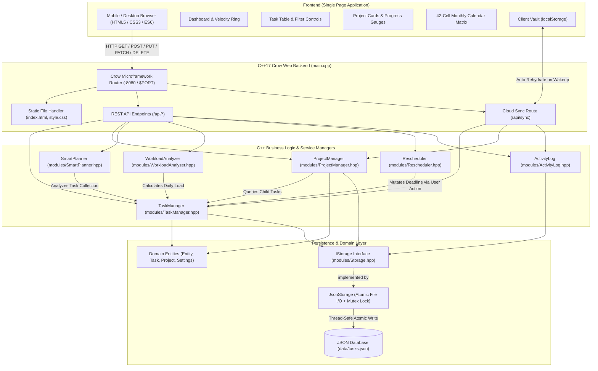
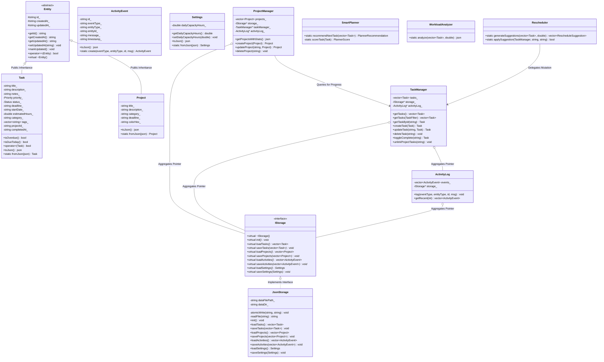
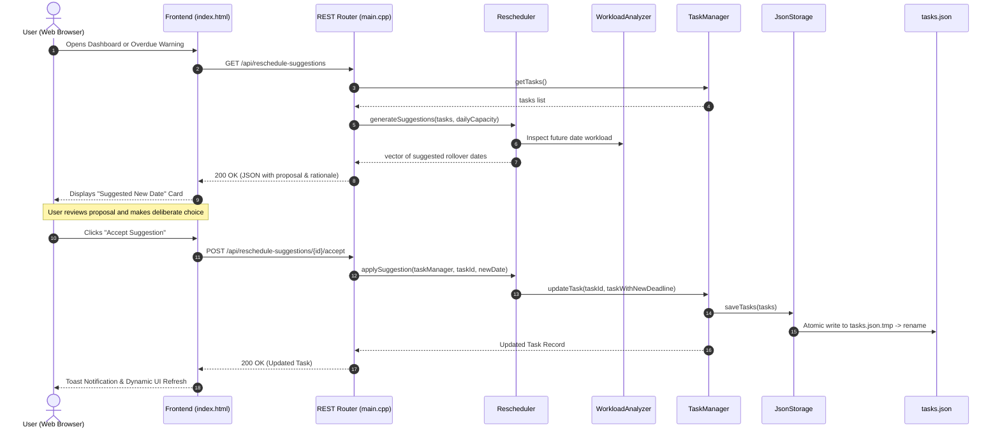
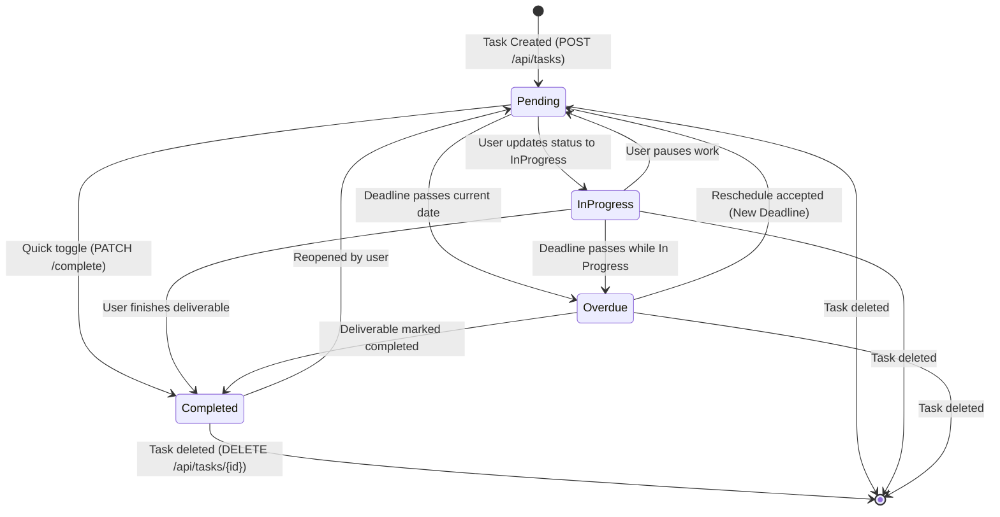

# TaskFlow – Smart Personal Task Management System

[](https://en.cppreference.com/w/cpp/17)
[](https://crowcpp.org/)
[](https://json.nlohmann.me/)
[](https://www.docker.com/)
[](https://task-management-system-58cy.onrender.com)
[](https://apple.com)
[](#)

> **TaskFlow** is a modern, high-performance personal productivity and workload management system engineered in **modern C++17** using the **Crow microframework**. It unites clean Object-Oriented Programming (OOP) design patterns with a calm, mobile-responsive **HTML5/CSS3/ES6 single-page web app**, containerized with **Docker** and deployed live to the cloud.

🔗 **Live Web Application**: [https://task-management-system-58cy.onrender.com](https://task-management-system-58cy.onrender.com)

---

## Table of Contents

1. [Executive Summary & Motivation](#1-executive-summary--motivation)
2. [Live Web App & Key Features](#2-live-web-app--key-features)
3. [Architecture & System Design](#3-architecture--system-design)
   - [System Architecture Flowchart](#system-architecture-flowchart)
   - [OOP Class Hierarchy Diagram](#oop-class-hierarchy-diagram)
   - [Task Rescheduling Lifecycle Sequence](#task-rescheduling-lifecycle-sequence)
   - [Task State Machine Diagram](#task-state-machine-diagram)
4. [Comprehensive OOP Concepts Mapping](#4-comprehensive-oop-concepts-mapping)
5. [Core Modules & Class Responsibilities](#5-core-modules--class-responsibilities)
6. [Technology Stack & Prerequisites](#6-technology-stack--prerequisites)
7. [Local Installation & Setup Guide](#7-local-installation--setup-guide)
8. [Docker & Cloud Deployment Guide](#8-docker--cloud-deployment-guide)
9. [REST API Reference](#9-rest-api-reference)
10. [Repository Directory Structure](#10-repository-directory-structure)
11. [Testing & Quality Verification](#11-testing--quality-verification)
12. [Engineering FAQ & Technical Deep-Dive](#12-engineering-faq--technical-deep-dive)
13. [Limitations & Future Roadmap](#13-limitations--future-roadmap)

---

## 1. Executive Summary & Motivation

### The Problem
Learners, developers, and knowledge workers juggle overlapping deliverables, shifting deadlines, and fluctuating daily bandwidth. Common existing tools suffer from two extremes:
* **Over-simplified to-do apps**: Lack intelligence, capacity guards, and contextual project grouping.
* **Bloated enterprise platforms**: Require costly monthly subscriptions, complex team setups, and invasive telemetry for simple personal productivity.

### The Solution: TaskFlow
TaskFlow delivers a dedicated, lightweight personal productivity workspace that:
1. **Runs Everywhere**: Works seamlessly on macOS, Linux, Docker containers, and mobile browsers.
2. **Prioritizes Deterministically**: Uses a local C++ algorithmic scoring engine that highlights what to tackle next with transparent, human-readable explanations.
3. **Guards Against Burnout**: Continuously balances daily scheduled hours against a customizable working capacity ceiling (e.g., 6.0 hours/day).
4. **Reschedules Non-Destructively**: Suggests realistic deadline adjustments for overdue deliverables without modifying records without explicit user consent.
5. **Survives Ephemeral Cloud Resets**: Uses an automated client-side vault (`taskflow_permanent_vault`) and cloud rehydration (`/api/sync`) so user data persists even across free-tier container sleep cycles.
6. **Exemplifies Modern C++ OOP**: Concretely applies abstraction barriers, runtime polymorphism, inheritance hierarchies, custom exception trees, RAII smart pointers, and thread-safe atomic persistence.

---

## 2. Live Web App & Key Features

### A. Executive Dashboard
* **Dynamic Metric Cards**: Real-time counts of Total, Pending, In-Progress, Completed, Overdue, and Due-Today tasks.
* **Velocity Gauge**: SVG progress ring visualizing task completion percentage.
* **"Next Focus" Spotlight**: Surfaces the top actionable task computed by the C++ Smart Planner with natural-language reasoning.
* **Urgency & Deadline Watchlists**: Shows high-priority items and deliverables approaching in the next 7 days.
* **Live Audit Activity Feed**: Chronological log of recent actions and timestamped updates.

### B. Personal Deliverable & Task Management
* **Full CRUD Operations**: Create, edit, toggle completion status, and safely delete deliverables.
* **Rich Metadata Attributes**: Title, description, notes, priority (`Low`, `Medium`, `High`, `Critical`), status (`Pending`, `In Progress`, `Completed`), deadline, start date, estimated hours, category, tags, and project association.
* **Flexible Natural Time Parser**: Accepts inputs in human formats (`1.5`, `1h 30m`, `45m`, `1:30`, `2 hrs`) with automated conversion and live badge previews.
* **Strict Validation Rules**: Requires a valid title, target deadline, and realistic estimated effort before saving.
* **Instant Client-Side Search & Multi-Filters**: Instant keyword search across titles and descriptions; multi-dimensional filtering by status, priority, category, or project.

### C. Project Initiatives
* **Project Organization**: Group tasks under initiatives with custom color badges, target deadlines, and descriptions.
* **Rollup Statistics**: Dynamically calculates completion percentages and total hours completed across child tasks.
* **Safe Unlink on Deletion**: Deleting a project retains associated tasks by safely converting them to standalone items instead of triggering cascading deletions.

### D. Smart Priority Planner (Rule-Based C++ Engine)
* **Local Deterministic Scoring**: Computes composite priority scores using multi-factor heuristics:
  $$\text{Score} = W_{\text{priority}} + W_{\text{urgency}} + W_{\text{effort}} + W_{\text{status}}$$
* **Transparent Justification**: Generates plain-English reasons explaining why a task was prioritized (e.g., *"Due within 24 hours with Critical priority (2.0 hrs est)"*).
* **Zero External Cloud Latency**: Operates completely in-memory on the backend without third-party API dependencies.

### E. Workload Capacity Guard & Smart Rescheduler
* **Configurable Daily Capacity**: Allows users to specify their personal working limit (default: 6.0 hours/day).
* **14-Day Workload Horizon**: Compares scheduled effort against daily bandwidth to flag overloaded days.
* **Capacity-Balanced Rollover**: Analyzes future calendar bandwidth to propose optimal rollover dates for overdue tasks with explicit user acceptance.

### F. Mobile-First Responsive Experience
* **Touch-Friendly Drawer Sidebar**: Smooth slide-out mobile navigation drawer with backdrop overlay.
* **Everyday, Universal Placeholders**: Clean, intuitive form examples and universal categories (`General`, `Work`, `Personal`, `Health`, `Finance`, `Study`).
* **Offline-Ready Client Vault**: Automatically backs up data to the device's local storage and provides one-click JSON backup export/import and fresh-start wiping.

---

## 3. Architecture & System Design

### System Architecture Flowchart



---

### OOP Class Hierarchy Diagram



---

### Task Rescheduling Lifecycle Sequence



---

### Task State Machine Diagram



---

## 4. Comprehensive OOP Concepts Mapping

TaskFlow was purposefully engineered to demonstrate modern C++ Object-Oriented Programming principles:

| OOP Concept | Target File | Code Location | Practical Demonstration in TaskFlow |
|---|---|---|---|
| **Classes & Objects** | `modules/Models.hpp` | Lines 75–655 | Discrete domain models (`Task`, `Project`, `ActivityEvent`, `Settings`) encapsulating real-world productivity entities. |
| **Encapsulation & Invariants** | `modules/Models.hpp` | Lines 120–230 | Member variables kept `private`; setters enforce validation bounds (e.g., `setEstimatedHours(0.02 to 100.0)`). |
| **Data Abstraction** | `modules/Storage.hpp` | Lines 15–35 | `IStorage` abstract class with pure virtual methods completely hides disk serialization details from service controllers. |
| **Inheritance** | `modules/Models.hpp` | Lines 100, 230 | `Task : public Entity` and `Project : public Entity` inherit identifiers, timestamps, and equality semantics. |
| **Runtime Polymorphism** | `modules/Storage.hpp` | Lines 38–215 | `JsonStorage` implements `IStorage` using virtual function overriding (`override` keyword) and virtual destructors. |
| **Interface Segregation** | `modules/Storage.hpp` | Lines 15–35 | Pure virtual interface decoupling business logic from specific file formats or database backends. |
| **Constructors / Destructors** | `modules/Models.hpp` | Lines 105–125 | Default and parameterized constructors with member initializer lists; `Entity` declares `virtual ~Entity() = default`. |
| **Function Overloading** | `modules/TaskManager.hpp` | Lines 35–45 | `getTasks()` returns all tasks, while overloaded `getTasks(TaskFilter)` applies multi-criteria filtering. |
| **Operator Overloading** | `modules/Models.hpp` | Lines 90, 240, 560 | `Task::operator<` compares urgency weights; `Entity::operator==` compares UUIDs; `operator<<` formats stream output. |
| **Custom Exception Hierarchy** | `modules/Models.hpp` | Lines 19–46 | Custom hierarchy: `TaskFlowException` $\rightarrow$ `ValidationException`, `NotFoundException`, `StorageException`. |
| **Generic Templates** | `modules/Models.hpp` | Lines 51–54 | Template utility `template<typename T> bool inRange(T val, T min, T max)` used across domain validators. |
| **Static Methods & Factory** | `modules/Models.hpp` | Lines 60–73, 150 | `DateUtils::nowIso()`, `DateUtils::todayDate()`, `Task::priorityToString()`, and `ActivityEvent::create()` static factory. |
| **Composition & Aggregation** | `main.cpp`, `TaskManager.hpp` | Lines 5–15 | `main.cpp` composes `std::unique_ptr<JsonStorage>`; `TaskManager` aggregates pointers to `IStorage` and `ActivityLog`. |
| **Smart Pointers (RAII)** | `main.cpp` | Lines 45–60 | `std::unique_ptr<JsonStorage>` manages heap storage lifetime cleanly without manual `delete` or memory leaks. |
| **STL Algorithms & Containers** | `SmartPlanner.hpp`, `Models.hpp` | Lines 5–30 | Extensive usage of `std::vector`, `std::map`, `std::set`, `std::sort`, `std::find_if`, and `std::min_element`. |
| **Thread-Safe Atomic File I/O** | `modules/Storage.hpp` | Lines 57–75 | Safe persistence via temporary files (`data/tasks.json.tmp` renamed to `data/tasks.json`) to prevent write corruption. |

---

## 5. Core Modules & Class Responsibilities

| Module File | Class Name | Responsibility |
|---|---|---|
| [`modules/Models.hpp`](file:///Users/aditya/Documents/mmcoe%20study/OOP/OOP_PROJECT/modules/Models.hpp) | `Entity` | Abstract base class declaring common fields (`id_`, `createdAt_`, `updatedAt_`), virtual destructor, and `operator==`. |
| [`modules/Models.hpp`](file:///Users/aditya/Documents/mmcoe%20study/OOP/OOP_PROJECT/modules/Models.hpp) | `Task` | Core deliverable model containing priority, deadline, status, effort, validation rules, and urgency comparator (`operator<`). |
| [`modules/Models.hpp`](file:///Users/aditya/Documents/mmcoe%20study/OOP/OOP_PROJECT/modules/Models.hpp) | `Project` | Personal initiative container holding color theme, category, deadline, and title validation. |
| [`modules/Models.hpp`](file:///Users/aditya/Documents/mmcoe%20study/OOP/OOP_PROJECT/modules/Models.hpp) | `ActivityEvent` | Immutable historical audit record created via static factory `ActivityEvent::create()`. |
| [`modules/Models.hpp`](file:///Users/aditya/Documents/mmcoe%20study/OOP/OOP_PROJECT/modules/Models.hpp) | `Settings` | Encapsulates user preferences (daily work capacity hours, default 6.0h). |
| [`modules/Models.hpp`](file:///Users/aditya/Documents/mmcoe%20study/OOP/OOP_PROJECT/modules/Models.hpp) | `DateUtils` | Static utility class providing ISO 8601 formatting, current date extraction, and calendar date differences. |
| [`modules/Storage.hpp`](file:///Users/aditya/Documents/mmcoe%20study/OOP/OOP_PROJECT/modules/Storage.hpp) | `IStorage` | Pure virtual interface defining repository contracts (`loadTasks`, `saveTasks`, `loadProjects`, etc.). |
| [`modules/Storage.hpp`](file:///Users/aditya/Documents/mmcoe%20study/OOP/OOP_PROJECT/modules/Storage.hpp) | `JsonStorage` | Concrete implementation of `IStorage` providing atomic, transactional file writes to `data/tasks.json`. |
| [`modules/TaskManager.hpp`](file:///Users/aditya/Documents/mmcoe%20study/OOP/OOP_PROJECT/modules/TaskManager.hpp) | `TaskManager` | Coordinates task collections, enforces business constraints, executes filtering and sorting, and unlinks projects safely. |
| [`modules/ProjectManager.hpp`](file:///Users/aditya/Documents/mmcoe%20study/OOP/OOP_PROJECT/modules/ProjectManager.hpp) | `ProjectManager` | Coordinates personal projects, computes aggregate statistics (total hours, percentage completed), and handles deletions. |
| [`modules/SmartPlanner.hpp`](file:///Users/aditya/Documents/mmcoe%20study/OOP/OOP_PROJECT/modules/SmartPlanner.hpp) | `SmartPlanner` | Rule-based decision engine calculating multi-factor heuristic scores and generating plain-language rationales. |
| [`modules/WorkloadAnalyzer.hpp`](file:///Users/aditya/Documents/mmcoe%20study/OOP/OOP_PROJECT/modules/WorkloadAnalyzer.hpp) | `WorkloadAnalyzer` | Aggregates daily pending workload, flags days exceeding user capacity, and tallies overdue metrics. |
| [`modules/Rescheduler.hpp`](file:///Users/aditya/Documents/mmcoe%20study/OOP/OOP_PROJECT/modules/Rescheduler.hpp) | `Rescheduler` | Simulates future calendar capacity to produce non-destructive reschedule recommendations for overdue tasks. |
| [`modules/ActivityLog.hpp`](file:///Users/aditya/Documents/mmcoe%20study/OOP/OOP_PROJECT/modules/ActivityLog.hpp) | `ActivityLog` | Maintains an in-memory and on-disk audit trail of chronological system actions. |

---

## 6. Technology Stack & Prerequisites

* **Language**: C++17 (`clang++` or `g++`).
* **Web Framework**: [Crow C++ Microframework v1.3.4](https://crowcpp.org/) (fast, header-only routing engine).
* **Asynchronous Networking**: [Standalone Asio v1.38.2](https://think-async.com/Asio/).
* **JSON Serialization**: [nlohmann/json v3.12.0](https://json.nlohmann.me/).
* **Containerization**: Multi-stage Docker image (Ubuntu 22.04 base).
* **Frontend**: Responsive HTML5, modern CSS3 (Custom Variables, Flexbox, Grid), and native ES6 JavaScript (Zero Node.js/npm dependencies).
* **Build System**: GNU Make.

---

## 7. Local Installation & Setup Guide

### macOS (Apple Silicon & Intel)

1. **Install Dependencies via Homebrew**:
   ```bash
   brew install crow asio nlohmann-json
   ```

2. **Clone the Repository**:
   ```bash
   git clone https://github.com/adityaph-17/TASK-MANAGEMENT-SYSTEM.git
   cd TASK-MANAGEMENT-SYSTEM
   ```

3. **Build and Run**:
   ```bash
   make clean
   make
   ./taskflow 8080
   ```

4. **Access the App**:
   Open [http://localhost:8080](http://localhost:8080) in your web browser.

---

### Linux (Ubuntu / Debian / WSL2)

1. **Install Compiler & Libraries**:
   ```bash
   sudo apt update
   sudo apt install -y build-essential clang libasio-dev nlohmann-json3-dev git
   ```

2. **Download Crow Header**:
   ```bash
   sudo wget https://github.com/CrowCpp/Crow/releases/download/v1.3.4/crow_all.h -O /usr/local/include/crow.h
   ```

3. **Compile & Execute**:
   ```bash
   make clean
   make
   ./taskflow 8080
   ```

---

## 8. Docker & Cloud Deployment Guide

TaskFlow includes a multi-stage `Dockerfile` ready for instant containerization and deployment to cloud platforms like **Render**, **Fly.io**, or **AWS**:

### 1. Build and Run with Docker Locally

```bash
# Build the Docker image
docker build -t taskflow .

# Run the container mapping port 8080
docker run -p 8080:8080 --name taskflow-app taskflow
```
Navigate to `http://localhost:8080`.

### 2. Live Cloud Deployment (Render)

1. Fork or push your repository to GitHub.
2. In the [Render Dashboard](https://dashboard.render.com/):
   * Select **New +** $\rightarrow$ **Web Service**.
   * Connect your GitHub repository.
   * Environment: **Docker**.
   * Region: Select your preferred region (e.g., Singapore, Frankfurt, Oregon).
   * Plan: **Free**.
3. Render automatically executes the multi-stage `Dockerfile`, dynamically binds to the assigned `$PORT`, and exposes the live URL with free automated SSL.

---

## 9. REST API Reference

All endpoints return standard HTTP status codes and JSON payloads:

| Method | Endpoint | Description | Sample Payload / Parameters |
|---|---|---|---|
| `GET` | `/` | Serves the single-page application | — |
| `GET` | `/style.css` | Serves stylesheet | — |
| `GET` | `/api/dashboard` | Dashboard metrics, overdue tallies, focus item | — |
| `GET` | `/api/tasks` | Returns filtered and sorted tasks | `?status=Pending&priority=High&sortBy=deadline` |
| `GET` | `/api/tasks/<id>` | Retrieves a single task record by ID | — |
| `POST` | `/api/tasks` | Creates a new task | `{"title":"Quarterly Review","priority":"High","estimatedHours":2.5,"deadline":"2026-12-01"}` |
| `PUT` | `/api/tasks/<id>` | Modifies an existing task | `{"title":"Review v2","status":"In Progress"}` |
| `PATCH`| `/api/tasks/<id>/complete` | Toggles completion status | — |
| `PATCH`| `/api/tasks/<id>/status` | Updates task status directly | `{"status":"Completed"}` |
| `DELETE`| `/api/tasks/<id>` | Permanently removes a task | — |
| `GET` | `/api/projects` | Returns all projects with progress stats | — |
| `GET` | `/api/projects/<id>` | Retrieves a single project record | — |
| `POST` | `/api/projects` | Creates a new project | `{"title":"App Launch","category":"Work","colorHex":"#245C4A"}` |
| `PUT` | `/api/projects/<id>` | Updates project metadata | `{"title":"App Launch v2","category":"Work"}` |
| `DELETE`| `/api/projects/<id>` | Unlinks child tasks safely & deletes project | — |
| `GET` | `/api/planner` | Deterministic priority recommendation & score | — |
| `GET` | `/api/workload` | Daily hours breakdown, capacity status, warnings | — |
| `GET` | `/api/calendar` | Tasks organized by deadline date | — |
| `GET` | `/api/reports` | Analytics distribution and project health metrics | — |
| `GET` | `/api/activity` | Audit event history log | — |
| `GET` | `/api/notifications` | Active system alerts for overloads & overdue tasks | — |
| `GET` | `/api/reschedule-suggestions` | Capacity-balanced rollover proposals for overdue tasks | — |
| `POST` | `/api/reschedule-suggestions/<id>/accept` | Accepts and applies recommended new deadline | — |
| `GET` | `/api/settings` | Returns user preferences (`dailyCapacityHours`) | — |
| `PUT` | `/api/settings` | Updates daily capacity limit | `{"dailyCapacityHours":7.0}` |
| `GET` | `/api/sync` | Full system snapshot export for client backup | — |
| `POST` | `/api/sync` | Rehydrates cloud database from client vault | `{"tasks":[],"projects":[],"activities":[],"settings":{}}` |

---

## 10. Repository Directory Structure

```
OOP_PROJECT/
├── Dockerfile                  # Multi-stage container build for cloud deployment (Render)
├── Makefile                    # Clang++ C++17 build targets (all, clean, run)
├── README.md                   # Comprehensive documentation, architecture & viva guide
├── changes.txt                 # Chronological development and testing log
├── plan.txt                    # Architectural specification and roadmap
├── compile_commands.json       # Language server flags for VS Code & Clangd
├── .clangd                     # Compiler search paths configuration
├── .gitignore                  # Git ignore rules for binaries, symbols, and caches
│
├── index.html                  # Responsive single-page application frontend
├── style.css                   # Forest green & muted sage design system stylesheet
├── main.cpp                    # Crow server bootstrap and REST route definitions
│
├── modules/                    # Modular C++ class headers
│   ├── Models.hpp              # Entity hierarchy, Task, Project, ActivityEvent, Settings
│   ├── Storage.hpp             # IStorage interface & JsonStorage atomic file implementation
│   ├── TaskManager.hpp         # Task collection management, filtering, and validation
│   ├── ProjectManager.hpp      # Project operations, task association, and progress rollups
│   ├── SmartPlanner.hpp        # Deterministic multi-factor priority scoring engine
│   ├── WorkloadAnalyzer.hpp    # Daily capacity calculations and overload detection
│   ├── Rescheduler.hpp         # Capacity-balanced date proposal engine
│   └── ActivityLog.hpp         # Event history recording and retrieval
│
└── data/
    └── tasks.json              # Local persistent JSON database (atomic safe writes)
```

---

## 11. Testing & Quality Verification

| Test Scenario | Action / Method | Expected Output | Verification Status |
|---|---|---|---|
| **Clean Compilation** | `make clean && make` | 0 errors, 0 warnings under `-Wall -Wextra` | **Passed** |
| **Static Web Serving** | `curl -s http://localhost:8080/` | HTTP 200 containing HTML structure | **Passed** |
| **Initial Empty State** | `GET /api/dashboard` | Clean JSON response with 0 counts | **Passed** |
| **Task Creation** | `POST /api/tasks` | Returns 201 Created with generated `tsk_*` ID | **Passed** |
| **Input Validation** | `POST /api/tasks` (empty title) | HTTP 400 Bad Request with validation message | **Passed** |
| **Natural Time Parsing** | Enter `1.5`, `1h 30m`, `45m` | Parsed accurately to decimal hours in backend | **Passed** |
| **Priority Comparator** | `Task::operator<` | Urgent & higher priority sorted first | **Passed** |
| **Completion Toggle** | `PATCH /api/tasks/<id>/complete` | Status updates to `Completed` with timestamp | **Passed** |
| **Project Progress** | `GET /api/projects` | Progress dynamically updates from child tasks | **Passed** |
| **Safe Project Delete** | `DELETE /api/projects/<id>` | Project removed; child tasks preserved standalone | **Passed** |
| **Overdue Detection** | Set task deadline to past date | Flagged as overdue; suggested in rescheduler | **Passed** |
| **Reschedule Acceptance** | `POST /api/reschedule-suggestions/<id>/accept` | Deadline updated; task removed from overdue | **Passed** |
| **Atomic Persistence** | Server kill & restart | Full data intact in `data/tasks.json` | **Passed** |
| **Cloud Rehydration** | Server sleep & wakeup on Render | Phone vault rehydrates database via `/api/sync` | **Passed** |

---

## 12. Engineering FAQ & Technical Deep-Dive

### Why C++17 and Crow for a Cloud Web Service?
* **Deterministic Resource Management**: C++17 provides deterministic object destruction through RAII (Resource Acquisition Is Initialization), eliminating garbage collection pauses and nondeterministic latency spikes.
* **Minimal Footprint**: Coupled with the header-only Crow microframework, the entire backend compiles down to a single compact binary (~2.5 MB) that boots in less than 50 milliseconds and consumes under 15 MB of RAM in production.
* **Compile-Time Safety**: Strict type checking and template-based validation catch data and memory errors at compile time rather than during runtime execution.

### Polymorphic Storage Abstraction (Repository Pattern)
The persistence layer decouples domain services from the physical filesystem using runtime polymorphism:
* **Contract Definition**: The abstract base class `IStorage` in `modules/Storage.hpp` declares pure virtual interfaces (`= 0`) and a `virtual ~IStorage() = default`.
* **Concrete Implementation**: `JsonStorage` implements the interface via `override`.
* **Inversion of Control**: Service controllers (`TaskManager`, `ProjectManager`, `ActivityLog`) depend strictly on abstract `IStorage*` references. This enables swapping the storage engine with SQLite, PostgreSQL, or an in-memory mock during unit testing without changing a single line of business logic.

### Domain Invariant Safety & Encapsulation Enforcement
* All domain entity properties in `modules/Models.hpp` (e.g., `estimatedHours_`, `status_`, `priority_`, `deadline_`) are strictly declared `private`.
* External mutations must traverse validated setter methods. For instance, `setEstimatedHours()` validates that inputs adhere to $[0.02, 100.0]$ hours, rejecting non-positive or irrational numbers with a typed `ValidationException`.
* This guarantees that entities in memory are always valid and adhere to domain invariants.

### Atomic, Fault-Tolerant Persistence Mechanism
To prevent corrupted database files during abrupt shutdowns, container restarts, or write interruptions:
1. Data serialization targets a temporary companion file (`data/tasks.json.tmp`).
2. The file stream is completely flushed and closed to ensure all bytes reach disk.
3. An atomic filesystem rename (`std::rename` / `rename(2)`) replaces the live `data/tasks.json` in a single operating-system inode switch.
4. If an interruption occurs mid-write, the existing database remains 100% intact and uncorrupted.

### Deterministic Heuristic Scheduling vs. Cloud LLMs
Rather than relying on non-deterministic, high-latency cloud language models, the `SmartPlanner` engine uses local multi-factor heuristics:
* **Urgency Weight**: Overdue items receive $+150\text{ pts} + 15\text{ pts/day}$; deliverables due today receive $+100\text{ pts}$.
* **Priority Coefficient**: `Critical` ($+90\text{ pts}$), `High` ($+60\text{ pts}$), `Medium` ($+30\text{ pts}$), `Low` ($+10\text{ pts}$).
* **Execution Momentum**: Active tasks in `In Progress` receive $+25\text{ pts}$.
* **Quick-Win Heuristic**: Deliverables with estimated effort $\le 1.0\text{ hour}$ receive $+20\text{ pts}$.
* **Performance**: Scans and sorts thousands of tasks in sub-millisecond $O(N \log N)$ time with transparent, explainable rationales.

### Ephemeral Cloud Persistence & Client-Side Vault Rehydration
Cloud free tiers (such as Render) deploy containers on ephemeral disk partitions that reset to base image upon idle sleep. TaskFlow addresses this via a zero-cost hybrid persistence architecture:
* Every create, update, or delete operation writes to the local browser `localStorage` under `taskflow_permanent_vault`.
* When the cloud container re-awakes with a fresh disk, the frontend triggers `/api/sync` via HTTP POST, rehydrating the C++ backend disk automatically.
* Users also maintain full control with manual JSON backup exports and imports in Workload Settings.

---

## 13. Limitations & Future Roadmap

### Current Scope & Design Boundaries
* **Single-User Workspace**: Intentionally optimized for personal solo productivity without multi-tenant authentication overhead.
* **JSON File Storage**: Designed for desktop/solo productivity workloads (thousands of tasks).

### Future Roadmap
* **External Calendar Integration**: Export deadlines to standard `.ics` (iCalendar) format for Apple Calendar and Google Calendar.
* **Native Push Notifications**: Web Push Notifications for approaching deadlines and capacity alerts.
* **Password-Protected Encryption**: Optional client-side AES-GCM encryption for backup files.

---

**Developed by**: Aditya Halne  
**Live Application**: [https://task-management-system-58cy.onrender.com](https://task-management-system-58cy.onrender.com)
